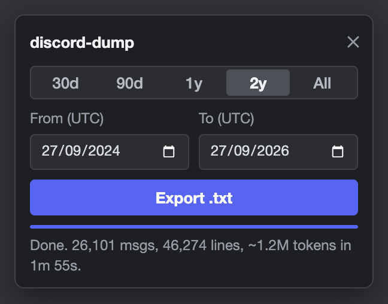

<div align="center">

# discord-dump

**Export a Discord channel as one .txt built for coding agents.**

[](https://github.com/carson2222/discord-dump/actions)
[](LICENSE)
[](#install)

[Install](#install) · [Format](#format) · [Numbers](#numbers) · [Limits](#limits)



</div>

&nbsp;

discord-dump is a Chrome, Brave and Edge extension that saves the open channel, thread or DM as one compact `.txt`. Each message starts a new line with its date and author, replies point at line numbers, and the header has a month index. The file is made for coding agents like Claude Code, opencode, Codex and Cursor. On a busy developer channel it came to about 47 tokens per message.

````text
# Discord export: Acme / #dev-support
Topic: Questions about the Acme API and SDKs. Staff answer weekdays.
Range: 2026-03-01 to 2026-03-31 (UTC). 8 messages, 4 authors, 28 lines, ~435 tokens.
Not included: thread replies, reactions, edit history, attachment and link contents.
Each message is one line: "YYYY-MM-DD author: text". Indented lines continue the message above.
"->bob L1234" replies to bob's message on line 1234. "->bob 2024-01-02 "text"" replies to a message before this range.
[bot] marks bots. [Role] marks server staff.
Exported 2026-04-01 08:00 UTC.

## Index (month: lines, messages, ~tokens)
2026-03: L18-28, 8 msgs, ~236

## People
Staff: Mod: Mara 2.
Top posters: Jonas 3, Mara 2, Priya 2, DeployBot 1.

## Messages
2026-03-02 Jonas: getting 429s from /v2/orders after ~40 req/s, is that the documented limit?
2026-03-02 Mara[Mod] ->Jonas L18: yes, 50/s per key. burst above that and you eat a 10s cooldown. batch them
2026-03-02 Jonas ->Mara L19: batching works, thanks. for anyone else:
  ```ts
  const res = await client.orders.batch(orders, { chunk: 40 });
  ```
2026-03-03 Priya: webhook signature fails on staging but not prod, same secret. headers attached [img]
2026-03-03 Mara[Mod] ->Priya L24: staging still signs with sha1, prod moved to sha256 in 2.3. use the new header
2026-03-04 DeployBot[bot]: [embed: api v2.3.1 deployed | staging + prod, 0 failed checks]
2026-03-04 Priya ->Mara 2026-02-27 "SDK 2.3 ships Monday, pin 2.2.x until then": confirmed on 2.3.1, both envs sign sha256 now
2026-03-05 Jonas: does the batch endpoint count toward the same 50/s bucket or its own?
````

## Install

No build step, no dependencies.

1. Clone or download this repo.
2. Open `chrome://extensions` (`brave://extensions`, `edge://extensions`) and turn on Developer mode.
3. Click Load unpacked and pick the `extension/` folder.
4. Pin the icon so it shows in the toolbar.

## Use

1. Open a channel, thread or DM on discord.com and click the icon.
2. Pick a range. Presets are 30d, 90d, 1y, 2y and All, or set From and To dates in UTC.
3. Click Export .txt. The file lands in Downloads, named like `discord_<server>_<channel>_<from>_to_<to>.txt`.

Once messages have loaded, Stop or an error saves them to a `_partial` file whose header says so.

## With an agent

Point the agent at the file. The index tells it which lines to read, so it doesn't have to load the whole file.

> Read the header of `discord_Acme_dev-support_2024-03-01_to_2026-03-01.txt`. Then find every message where staff mention rate limits and summarize what changed over time, citing line numbers.

## Numbers

Measured on a busy public developer channel.

| Range   | Messages | Lines  | Tokens (o200k) | Time   |
| ------- | -------: | -----: | -------------: | -----: |
| 30 days |      194 |    385 |           ~11k |    1 s |
| 2 years |   26,101 | 46,274 |         ~1.24M | 1m 55s |

Times are with the server's staff list cached. The first export on a server took 16 s for the same 30 days.

All 11,440 in-file reply references in the 2-year export resolve to the message they answer. Per-day counts match a separate backward pass.

## Format

- Each message starts on its own line with `YYYY-MM-DD author: text`. Lines indented two spaces continue the message above.
- `->bob L1234` is a reply to the message on line 1234. `->bob 2024-01-02 "snippet"` is a reply to a message before the range. `->deleted` marks a reply to a deleted message, and `->unavailable` one that Discord didn't return.
- `[bot]` and `[Role]` after a name mark bots and server staff, for example `Mara[Mod]` or `Sam[Core Team]`.
- The header has the topic, range, counts, a month index (`2026-03: L412-1180, 812 msgs, ~38k`) and a People section with staff by role and top posters.
- Attachments become `[img]`, `[video]` or `[file: name.pdf]`. Embeds, polls, forwards, stickers and slash commands get short inline tags.
- Dropped: reactions, link previews, file URLs, per-message times, edit history.
- No line is longer than 1896 characters, so Read tools that truncate at 2000 never cut a message.
- All dates are UTC.

## How it works

The panel runs inside the Discord tab and reuses your logged-in session. There is no token to copy and nothing to paste. It pages through Discord's own message API, 100 messages per request, instead of scrolling the DOM, so it works with the tab in the background. Nothing leaves the browser except requests to discord.com.

A role counts as staff if it's shown separately in the member list and sits at or above the lowest such role with moderation permissions. Staff lists are cached locally for 7 days, because Discord rate-limits the lookup.

## Limits

- Reading messages through the API with a user account is against Discord's Terms of Service. Every request is read-only, it fetches message pages one after another, and it waits out rate limits, but use it at your own risk. Not affiliated with Discord.
- A channel export skips thread replies. Open the thread and export it on its own.
- Forum parents can't be exported. Open a post instead.
- An All export sits in memory until the file is written. For huge channels, export a year at a time.
- Discord can change its client or API at any time and break this.

## Development

```bash
node --test
```

Edit files in `extension/`, reload the extension at `chrome://extensions`, then refresh the Discord tab.

## License

MIT
